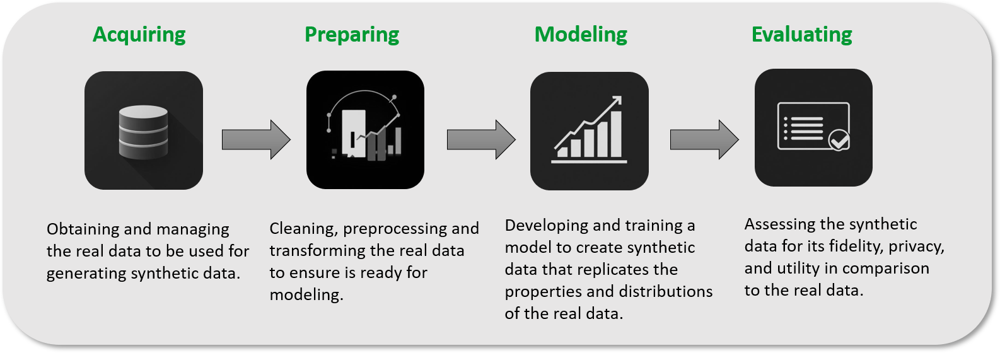

# SynGPipe

<details open> 
<summary> Table of Contents</summary>

- [Description](#description)
- [Installation](#installation)
- [Workflow Overview](#workflow-overview)
- [Example Datasets](#example-datasets)
- [Documentation](#documentation)
- [License](#license)
- [Project status](#project-status)

</details>

## Description

**SynGPipe** implements a pipeline-based synthetic data generation tool, developed as part of **PHASE-IV AI**. It supports key stages of the synthetic data generation pipeline and is designed for users with access to pseudonymized real datasets who wish to further anonymize their data by generating synthetic equivalents.

As a **prototype**, **SynGPipe** enables users to explore various synthetic data generation methods and evaluate the results through a flexible, interactive workflow. It serves as a platform for testing concepts and features, and for gathering feedback. **SynGPipe** facilitates systematic experimentation with different synthesizers and provides evaluation capabilities to assess the **quality** and **privacy** of the generated synthetic data.


### Synthetic Data Generation Pipeline Diagram




## Installation
**SynGPipe** is implemented as a Jupyter Notebook and is designed to run within a pip-based Conda environment. To ensure proper setup and reproducibility, please make sure that either [Miniconda](https://docs.conda.io/en/latest/miniconda.html) or [Anaconda](https://www.anaconda.com/) is installed on your system before proceeding.

### 1. Open Conda Terminal and check if Git is installed
In the Anaconda Prompt (Windows) or terminal (macOS/Linux), run:
```bash
git --version
```
If you get an error like `command not found`, Git is not installed.

```bash
# Install Git via Conda:
conda install git 
```

### 2. Clone the repository
```bash
git clone https://github.com/TurkuML/SynGPipe.git
```

### 3. Move into the cloned repository folder
```bash
cd syngpipe
```

### 4. Setup the environment
**- Automated Setup (Recommended)**

Run the setup script to create the Conda environment, install all dependencies, and register it in Jupyter automatically:

```bash
python setup_env.py syngpipe_env
```
After the environment setup is complete, activate the environment.
```bash
# To activate the environment, run:
conda activate syngpipe_env
```

**- Manual Setup (Alternative)**

If you prefer to set up the environment manually, run the following commands in order:

```bash
# Create the environment
conda create -n syngpipe_env python=3.10 git

# Activate the environment
conda activate syngpipe_env

# Install dependencies
pip install -r requirements.txt

# Register the environment in Jupyter
python -m ipykernel install --user --name syngpipe_env --display-name "Python (syngpipe_env)"
```

### 5. Launch JupyterLab and run SynGPipe.ipynb

```bash
# To launch JupyterLab, run: 
jupyter lab
```
> In JupyterLab, open **SynGPipe.ipynb** from the file browser and run it by pressing **Shift+Enter**.<br>
> **Note:** Ensure `Python (syngpipe_env)` kernel is selected before running the notebook.<br><br>
> **Important:** When running `SynGPipe.ipynb`, the code cell will be hidden, and only the graphical interface will be visible.<br>
> You may need to **scroll up** to see the start: **1. Upload a CSV file for the Real dataset**.<br>
> To reveal the hidden code cell, right-click and select **Clear Output of All Cells**.

## Workflow Overview
The synthetic data generation process in **SynGPipe** includes the following key steps:

### Step 1: Access to Real Dataset

- Users upload a **pseudonymized tabular dataset** in CSV format.
- Assumes all **direct identifiers have been removed** during pseudonymization.

### Step 2: Data Preparation

Basic setup and preprocessing are applied to make the dataset ready for synthetic generation. This includes:

- **Handling Missing Values**: Rows containing `null` values are removed.
- **Random Seed**: A seed is chosen for the train/test split, the non-DP synthesizers and all evaluation steps. DP synthesizers are intentionally not seeded.
- **Automatic Metadata Extraction**: Data types are detected automatically and can be adjusted manually. Users can flag variables as **sensitive**, such as quasi-identifiers.
- **Range and Category Extraction**:
  - Continuous variables: Minimum and maximum values are detected.
  - Categorical variables: categories are extracted.
- **Data Splitting**:
  - The dataset is split evenly (50/50) into **training** and **test** sets.
- **Discretization Options** (for continuous variables):
  - **Manual:** Specify min/max values (defaults are based on the training set).
  - **Training set min/max boundaries:** Computed from the training set (may pose a privacy risk).
  - **DP-based:** Estimate boundaries from the DP cumulative distribution (may impact utility).
  - **All-categorical**: If no continuous variables exist, discretization is skipped.
- **File Management**:
  - A dedicated subfolder is automatically created under the `./Results` directory, named after the uploaded Real dataset.
  - This folder stores:
      - Extracted metadata and any user-modified configurations in JSON format.
      - The training and test splits, saved as separate files.
  - This structure helps keep all files related to a dataset organized in one place for easy access and reproducibility.

### Step 3: Modeling

Users can select and train one of the following synthesizers:


| Type             | Synthesizer         | Implementation |
|------------------|---------------------|----------------|
| **Baseline**     | Baseline: Identity  | Copy of the Train (Real) dataset |
| **Statistical**  | GaussianCopula      | `synthesizers/gauss_copula/copula.py` |
| **GAN-based**    | WGP: CTGAN          | `synthesizers/ctgan/wgpctgan.py` (CTGAN trained with the WGAN-GP loss) |
| **DP-based**     | DP: AIM             | SmartNoise Synth (`aim`) |
| **DP-based**     | DP: MWEM            | SmartNoise Synth (`mwem`) |
| **DP-GAN-based** | DP: PATE-CTGAN      | SmartNoise Synth (`patectgan`) |

- For DP-based methods, a **privacy budget (ϵ)** must be specified.
- The synthesizers are trained on the Train (Real) dataset.
- A synthetic dataset (same size as the training set) is generated and displayed.

### Step 4: Evaluation
Users can choose to run the following evaluation reports:

- **Fidelity Report**: Measures similarity between real and synthetic data.
- **Privacy Report**: Assesses record proximity and membership-inference risk.
- **Utility Report**: Evaluates how well the synthetic data supports downstream tasks.

Evaluation results are computed and presented interactively.

## Example Datasets
This repository includes a **demo dataset** obtained from the following publications:<br>

**Radtke, Jan Philipp et al.**<br>
*Prediction of significant prostate cancer in biopsy-naïve men: Validation of a novel risk model<br>
combining MRI and clinical parameters and comparison to an ERSPC risk calculator and PI-RADS.*<br> 
PloS one vol. 14,8 e0221350. 26 Aug. 2019.<br>
[DOI:10.1371/journal.pone.0221350](https://journals.plos.org/plosone/article?id=10.1371/journal.pone.0221350),
[Data Availability](https://doi.org/10.1371/journal.pone.0221350), License: [CC BY 4.0](https://creativecommons.org/licenses/by/4.0/)

**Lee, Seung Soo et al.** <br>
*Usefulness of Bi-Parametric Magnetic Resonance Imaging with B=1800 s/Mm2 Diffusion-Weighted Imaging<br> 
for Diagnosing Clinically Significant Prostate Cancer.*<br> 
The world journal of men's health vol. 38,3 (2020): 370-376.<br> 
[DOI:10.5534/wjmh.190079](https://wjmh.org/DOIx.php?id=10.5534/wjmh.190079), 
[Data Availability](https://doi.org/doi:10.7910/DVN/R35JV9), License: [CC0 1.0](https://creativecommons.org/publicdomain/zero/1.0/)

**Zhang, Kai et al.** <br>
*Distribution of Prostate Imaging Reporting and Data System score and diagnostic <br> 
accuracy of magnetic resonance imaging-targeted biopsy: comparison of an Asian and European cohort.*<br>
Prostate international vol. 7,3 (2019): 96-101.<br> 
[DOI:10.1016/j.prnil.2018.10.001](https://www.sciencedirect.com/science/article/pii/S2287888218300588?via%3Dihub),
[Data Availability](https://data.mendeley.com/datasets/5sxfpyzmx4/1), License: [CC0 1.0](https://creativecommons.org/publicdomain/zero/1.0/)


The **demo dataset** contains clinical and imaging-related information used to study the detection of<br> 
clinically significant prostate cancer. It is based on patients who underwent MRI-guided targeted and systematic prostate biopsies.

This publicly available real dataset includes the following variables:
- **Age**: Patient’s age (years)
- **Prostate-Specific Antigen (PSA)**: PSA level measured before the MRI (ng/ml)
- **Volume**: Prostate volume from MRI using ellipsoid formula (cc)
- **PIRADS**: 5-point radiologist score (PI-RADSv2.1)
- **Sig_cancer**: Biopsy result, here Gleason score >= 7 is considered clinically significant prostate cancer. 

This dataset is provided **only as a demonstration dataset**. It is intended to:

- Serve as an example input for testing the synthetic data generation pipeline.
- Allow users to validate that the pipeline runs correctly.
- Demonstrate the expected input format for real-world clinical data.

> ⚠️**Note**: This dataset is not intended for clinical research or diagnostic use within this repository.<br>
> Users interested in detailed analyses should refer to the original publications.
> The demo dataset is not covered by the Apache 2.0 license; it is subject to the licenses of the original sources.

## Documentation

For detailed documentation on SynGPipe visit the **[SynGPipe Wiki](https://)**.

## License

SynGPipe is licensed under the Apache License 2.0.<br>
You are free to use, modify, and distribute the software in accordance with the terms of the license.<br>
See the [LICENSE](LICENSE) file for the full license text.

## Project status
**Prototype under active development.**

This tool is currently in a prototype phase and is actively being developed as part of **PHASE-IV AI** (grant number 101095384).<br>
Features and functionality may change as the design evolves, and feedback is welcome to guide future improvements.

> **Note:** For rapid design, implementation, and reproducibility, the prototype of the tool is built as a Jupyter Notebook.
> A more complete implementation can be developed using advanced back-end and front-end technologies to enhance usability and scalability.
